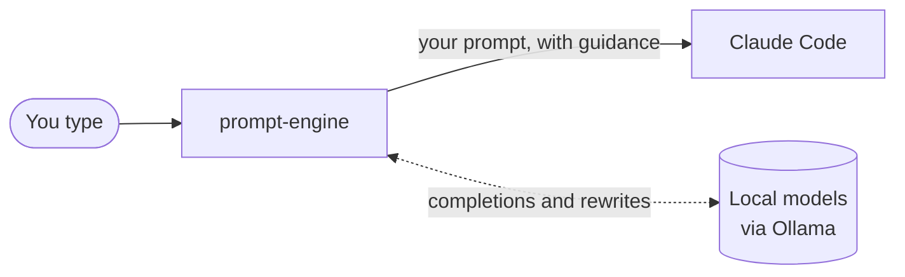

# prompt-engine

[](https://github.com/pmvieira93/prompt-engine-cli/actions/workflows/ci.yml)
[](https://github.com/pmvieira93/prompt-engine-cli/releases)

**Better prompts for Claude Code, written as you type, without leaving your terminal.**

You use `claude` exactly as before. `prompt-engine` sits in front of it and helps you write the prompt; Claude Code does the work.


## What it does

| | |
|---|---|
| **[Ghost text](docs/guide/ghost-text.md)** | Grey completions finish your words and sentences as you type. Tab takes them. |
| **[Prompt rewrites](docs/guide/rewrites.md)** | A rough prompt becomes a clear one: typos fixed, names and meaning kept. You choose when: on a shortcut, as a preview, or on every Enter. |
| **[Guidance](docs/guide/guidance.md)** | Your standing rules ("Run the tests before saying it works") go with every prompt, or only with the prompts they fit. |
| **[Guard rails](docs/guide/guard-rails.md)** | A rewrite that adds a task, drops a name or changes your meaning is stopped. You can add your own rules. |
| **[Side panel](docs/guide/panel.md)** | Shows what you typed against what was sent, and the session's settings. |

## How it works



- **Local.** Completions and rewrites come from models on your machine, through [Ollama](https://ollama.com). Your prompts don't go anywhere else before they reach Claude Code.
- **Drop-in.** Every argument goes on to `claude` (`prompt-engine --resume` works), and every Ctrl key still belongs to Claude Code. `prompt-engine`'s own shortcuts sit behind one leader key, **Ctrl+Q**.
- **Live settings.** Edits to the config file apply while it runs. The side panel says when a setting needs a restart.
- **Safe fallback.** If its display layer fails, `prompt-engine` switches to plain pass-through and your session goes on. Without a terminal (for example `prompt-engine -p "…" | less`), it hands over to `claude` directly.

## Quick start

It runs on macOS and Linux, and needs Claude Code and Ollama. The install script checks for both and offers to install what's missing:

```sh
curl -fsSL https://raw.githubusercontent.com/pmvieira93/prompt-engine-cli/master/install.sh | bash
```

Then run `prompt-engine` wherever you'd run `claude`. **[Getting Started](docs/GETTING_STARTED.md)** walks you through your first rewrite and has the shortcut cheat sheet.

## Documentation

| | |
|---|---|
| **Use it** | [Getting Started](docs/GETTING_STARTED.md): first run, shortcuts, recipes and troubleshooting. The guides: [ghost text](docs/guide/ghost-text.md), [rewrites](docs/guide/rewrites.md), [guidance](docs/guide/guidance.md), [guard rails](docs/guide/guard-rails.md), [side panel and history](docs/guide/panel.md) |
| **Set it up** | [Install](docs/install.md): requirements, every way to install, upgrading and uninstalling. [Local models](docs/models.md): which models, and the alternatives. [Configuration reference](docs/reference.md): every setting, flag, environment variable and file |
| **Build it** | [Testing guide](docs/TESTING.md): the manual test plan and the automated tests. [PRD](PRD.md) and its appendices: requirements and design decisions. [Spikes](docs/spikes/README.md): what was measured before a decision |

## License

[MIT](LICENSE)
