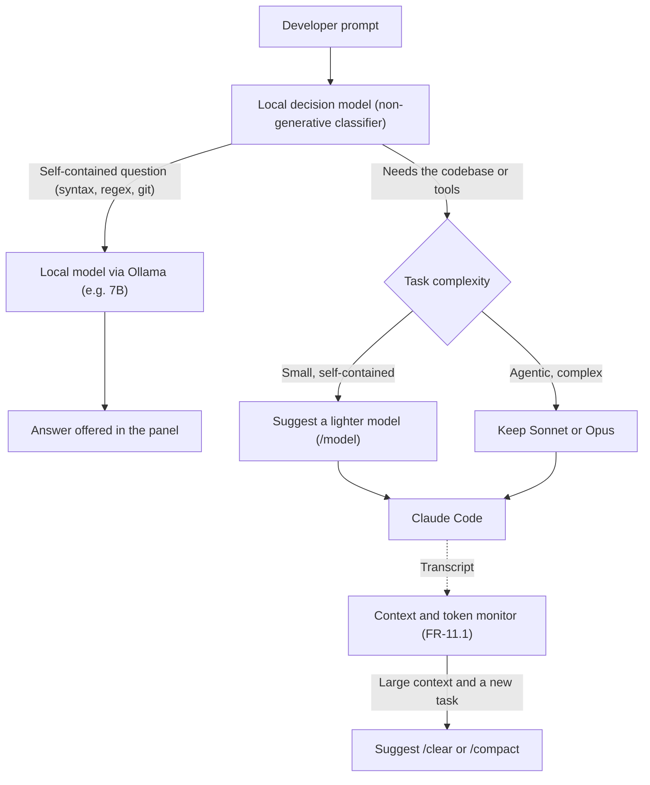

# PRD Appendix 5: Cost-Aware Local Assistance

**Extends:** [PRD.md](../PRD.md) version 1.2.5 (section 2, core value proposition; section 4.2, the local AI engine; the Phase 5 roadmap)  
**Appendix Version:** 1.3.1  
**Date:** 2026-11-10  
**Status:** Spike step 1 done, decided on 2026-11-09 (section 7): FR-11.1 built on 2026-11-09 (section 9), FR-11.2 dropped, FR-11.3 and FR-11.4 still proposed. A cost benchmark (section 8) proposed on 2026-11-09, after FR-11.1. On 2026-11-10, FR-11.3 and FR-11.4 proposed with a small non-generative decision model, to be compared with keyword rules in spike steps 3 and 4. Raised on 2026-10-30.

---

## 1. Background

`prompt-engine` uses local models (Ollama) for two things: ghost text and prompt rewrites. The idea is to use them for a third: **lowering what a session with a hosted AI coding assistant costs, in tokens and in time**. The local model would do the work it can do well, and leave the hosted model (Claude Code with Opus or Sonnet, and later GitHub Copilot, Gemini and others) the work that needs it.

### 1.1 Where the tokens go

`prompt-engine` only sees what the developer types and pastes. Most of a session's tokens are Claude Code's own context:
* its system prompt and tool definitions;
* the files it reads and the tool output;
* the whole conversation, resent on each turn.

So making the typed prompt shorter saves almost nothing directly. The savings `prompt-engine` can reach come from:

1. **Fewer turns.** A clear first prompt avoids round trips ("what do you mean by…?"). Expansion already aims at this; it isn't measured.
2. **Smaller inputs.** Pasted logs, stack traces and diffs are often thousands of tokens, mostly noise, and they stay in the context for the rest of the session.
3. **Not asking the hosted model.** Some questions don't need the agent: "what does this regex do?", "explain this error message".
4. **A cheaper model or a smaller context.** A lighter model for easy tasks (Claude Code's `/model`), and `/compact` or `/clear` once the context holds things that no longer matter.

### 1.2 What can be measured

Claude Code's session transcript (read since FR-6.3, [Appendix 1](PRD-APPENDIX-1.md), 2.5) records each reply's token usage, in the `usage` field of `assistant` records. Savings can be measured from the developer's real sessions, not estimated.

### 1.3 Local hardware and hosted costs

Developer laptops (such as Apple Silicon Macs with unified memory or Linux workstations with GPUs) have local compute that could run small models alongside the developer's work. Using a small local model to triage prompts (answering self-contained questions locally, suggesting a lighter model for simpler tasks, or pointing out when context could be cleared) could reduce hosted token usage. Whether this produces meaningful savings against what Claude Code carries in context remains a hypothesis for the cost benchmark (section 8) to test.

---

## 2. Proposal (FR-11)

Ranked by expected savings against risk. Every action is a **suggestion the developer approves**; `prompt-engine` never changes what is sent, or which model answers, on its own.

The proposed flow for FR-11.3 and FR-11.4, neither of them built or decided (section 7):

The prompt always goes to Claude Code when the developer presses Enter; every arrow out of the decision model ends in a suggestion.

* **FR-11.1: Cost visibility.** *Built on 2026-11-09 (section 9).* The panel shows the session's tokens so far (input, output, cache reads) and those of the last reply, from the transcript.
  * The history records them per prompt.
  * This comes first: the other features are judged by it.
* **FR-11.2: Condensed pastes.** *Dropped on 2026-11-09 (section 7).* When a paste is large (a log, a stack trace, a diff), the local model prepares a condensed version: the errors, the lines around them, and what repeats, counted.
  * The panel shows both sizes, and a shortcut swaps the condensed version in.
  * The original is kept: the shortcut undoes it, and the developer can always send the full paste.
* **FR-11.3: Local answers and routing.** A small local classifier would decide whether a prompt needs the agent (files, commands, edits, the session) or is a self-contained question.
  * The classifier would be a small non-generative model (e.g. ModernBERT-based), not a generative one. Routing is a choice among a few fixed labels: a classifier answers in one pass, in milliseconds, and can only return one of those labels. A generative model writes its answer token by token, and its replies drift from the format asked for ([intent spike](spikes/intent.md)).
  * The same decision feeds FR-11.4.
  * For self-contained questions (such as syntax, regex, git command options or error messages), the local model's answer would be offered in the panel; Enter would still send the prompt to Claude Code as usual.
  * Guards would stop local answers that look unsure or that reference the project.
* **FR-11.4: Model and context hints.** The classifier would estimate task complexity and context continuity:
  * Suggest a lighter model (e.g. Haiku 5.5 via `/model`) for small, self-contained tasks, leaving Sonnet 5.5 or Opus 5.5 for agentic work.
  * Suggest `/compact` or `/clear` when the context is large and the new prompt appears to start an unrelated task, to avoid carrying forward obsolete context.
  * `prompt-engine` would only suggest; the developer would run the command.
* **FR-11.5 (later, not in scope yet): Split calls below Claude Code.** A local proxy between Claude Code and its API (Claude Code accepts a custom API address) could:
  * send small calls (titles, summaries, quick checks) to a local model;
  * condense tool output before it reaches the hosted model.

  This is the most powerful option, and the most fragile:
  * it depends on the API format;
  * it changes how the agent behaves and what is billed;
  * it needs its own appendix and a separate decision.

### 2.1 Other providers

FR-11.1 to FR-11.4 work at the prompt, so they carry over to the other CLIs of Phase 5 (GitHub Copilot, Gemini, Aider) once `prompt-engine` wraps them. Only reading token usage (FR-11.1) depends on each CLI's own records.

---

## 3. Risks

* **A condensed paste drops the line that mattered.** Mitigations:
  * the developer sees both versions and chooses;
  * the original is kept;
  * the spike measures how often the cause survives.
* **A wrong local answer, trusted.** Mitigations:
  * local answers are offered beside the prompt, never instead of it;
  * they are labelled with the local model's name;
  * guards stop unsure ones.
* **Savings too small to matter.** Since most tokens are Claude Code's own context (1.1), the savings may be modest. The spike decides before anything is built.
* **Memory and speed.** A third use of the local models competes with ghost text and rewrites for the same memory and GPU.

---

## 4. Spike: does it pay off?

Before building, answer with data:

1. **Baseline.** From the developer's own Claude Code transcripts (read locally, nothing sent anywhere):
   * tokens per session and per turn;
   * how much of the input comes from pastes;
   * how many turns are clarifications;
   * how large the context grows before `/compact` or `/clear`.
2. **Condensing.** 10–20 real pasted logs, traces and diffs, each condensed by candidate local models. Measure:
   * tokens saved;
   * whether the cause is still there, checked by hand and by sending both versions to Claude Code with the same question.
3. **Routing.** A set of prompts, each labelled three ways: "needs the agent" or "self-contained"; the model tier it needs (Haiku, or Sonnet and Opus); and whether it starts a new task or continues the last one.
   * The developer's real prompts stay local: they are labelled on the developer's machine and only totals are committed, as in the earlier spikes. Synthetic prompts can be committed whole.
   * Three approaches run on the same set:
     * keyword rules plus the context size, like FR-12's keyword sections ([Appendix 6](PRD-APPENDIX-6.md));
     * the small non-generative classifier;
     * a small generative model through Ollama.
   * Measure each one's accuracy and latency. Wrong "local" and wrong "new task" decisions are the costly ones.
   * Measure how many local answers are good enough to make the hosted call unneeded.
   * The classifier is worth adding only if it clearly beats the keyword rules; otherwise FR-11.3 and FR-11.4 use the rules.
4. **Models.** Compare the local models available at the time for each use, with speed and memory on the developer's machines:
   * **Deciding:** the classifier against small generative models (1.5–3B), including its memory alongside the models already loaded for ghost text and rewrites.
   * **Answering:** a local chat model through Ollama, likely 7B or more.
5. **Outcome.** For each of FR-11.1 to FR-11.4: build, change, or drop, with the numbers. FR-11.1 is likely worth building whatever the outcome, since it's what shows the others' effect.

The spike's code and results go in `docs/spikes/`, like the earlier spikes.

---

## 5. Open decisions

* **Where local answers appear:** the panel (proposed), or inline in the prompt box.
* **Runtime for the decision model:** an embedded runtime inside the binary (e.g. ONNX Runtime or Candle via cgo) vs a separate local sidecar process. An embedded runtime complicates static cross-compilation in `scripts/build-release.sh` and single-binary installation in `install.sh`. A sidecar process keeps the binary standalone, matching how Ollama is used.
* **Whether FR-11.5 (the API proxy) is ever in scope.**
* ~~Whether token usage goes in the history by default,~~ or only with an option. Decided 2026-11-09: by default, as numbers only (section 9).

---

## 6. Roadmap

FR-11.1 is built (section 9). Next when picked up: the cost benchmark (section 8). FR-11.3 and FR-11.4 wait for both, so their effect can be measured; FR-11.3 also needs spike step 3 first.

---

## 7. Decisions after the spike (2026-11-09)

Step 1 of the spike ([token baseline](spikes/token-baseline.md), sections 4 and 5) measured 63 sessions and 633 prompts from the developer's own transcripts. Pastes are 0.1% of the input tokens, even counting every time a later call reads them back. Typed text is 0.2%. Prompts that answer a real clarifying question are 7.6%, and most of those ask for a decision or a hand-test result. Nearly all the input is what Claude Code carries: its replies, tool results, system prompt and thinking.

* **FR-11.1, cost visibility: build.** It's cheap, and it's how any other saving would show.
* **FR-11.2, condensed pastes: dropped.** Large pastes are rare, and they are a fraction of a percent of the tokens even when read back on every call. Spike steps 2 and 4 for condensing aren't needed.
* **Rewrites are worth it for intent, not for tokens.** A clearer prompt saves few turns, since few clarifications are about the prompt. Its value is that Claude does what the developer means ([Appendix 6](PRD-APPENDIX-6.md)). Rework after a misunderstood prompt wasn't measured. Section 1.1's first saving, "fewer turns", is kept as a reason for rewrites, not as a cost saving.

FR-11.3 (local answers) and FR-11.4 (model and context hints) stay proposed. FR-11.4 is the only item aimed at what Claude Code carries; FR-11.5 is the only one that could change it directly, and stays out of scope.

---

## 8. Cost benchmark (after FR-11.1)

The spike measured where the tokens go in past sessions. The benchmark measures what `prompt-engine` changes: the same tasks, run with Claude Code alone and with `prompt-engine` and its local models, compared on cost.

### 8.1 Setup

* **A small test project**, kept in the repo for this purpose: a little app with planted bugs and small features to add, and hidden tests that decide whether each task is done.
* **10–20 tasks**, each written as a rough prompt, the way a developer types it.
* **Two setups**, same Claude model and settings:
  * **Claude alone:** the rough prompt, sent as it is;
  * **with `prompt-engine`:** the same prompt after the rewrite, with the developer's guidance added, and later with FR-11.3 and FR-11.4 once they exist.
* **Each task run 3–5 times per setup**, in a fresh session, because Claude's answers vary. The report gives the median of each measure.

### 8.2 Measures

| Measure | From |
|---|---|
| Tokens (input, output, cache) and cost in dollars | `claude -p --output-format json`, the same figures FR-11.1 shows |
| Time to finish | the same output, plus the rewrite's time |
| Turns to finish | the same output |
| Task done | the hidden tests |
| Local cost: CPU, memory and time of the Ollama calls | measured around each rewrite |

A cheaper run that fails the task isn't a saving, so cost is compared on the tasks both setups finish, and the success rate is reported beside it.

### 8.3 How it runs

* **Without the interactive screen.** With no terminal, `prompt-engine` hands over to `claude` directly, so nothing is rewritten. The benchmark needs a non-interactive command that rewrites a prompt and adds the guidance, with the same code as the interactive path; its prompt then goes to `claude -p`.
* **Ghost text is left out:** it saves typing time, which needs a person, timed by hand.
* **Results** go in `docs/spikes/`, like the spikes, with totals only.

### 8.4 What it is expected to show

Section 7 suggests tokens and cost will come out about the same: what the developer sends is under 1% of the input. Fewer turns or a higher success rate would be the saving, if there is one. An equal result is still the answer FR-11 needs: it says where savings aren't.

Once FR-11.3 and FR-11.4 exist, two effects decide what they save, and the benchmark measures both:

* **Switching models has a cost.** The prompt cache is kept per model, so changing model in the middle of a session reads the whole context again at the full input price. A model hint pays off mainly at the start of a task, right after `/clear`; this makes the "new task" decision the more valuable one.
* **Cached context is cheap.** Reading the context from the cache costs about a tenth of the normal input price, so answering a trivial question locally saves less than the context size suggests, except against Opus with a large context.

A benchmark of `prompt-engine` overall (rewrite quality, guard rails, other tools from Phase 5) is for later, and would reuse this project and harness.

---

## 9. FR-11.1 as built (2026-11-09)

* **Where the numbers come from.** Each assistant record in Claude Code's transcript carries its API call's `usage`: fresh input, cache writes, cache reads and output. `prompt-engine` already finds the session's transcript (Appendix 1, FR-6.3). It reads it every 2 seconds, only the lines added since the last read, and counts each call once by its message id: a reply written as several records repeats its usage. A first read of a 72 MB transcript took 0.2 s; later reads take under 1 ms.
* **Panel.** The Session section shows, once a reply arrives:
  * **context:** the last call's input, and the model;
  * **reply** and **so far:** input (with the share read from the cache) and output, for the last prompt's calls and for the conversation;
  * **calls:** how many API calls each made.

  `/clear` starts the count again, since Claude Code starts a new transcript. Subagents keep their own transcripts (`<session>/subagents/*.jsonl`); their calls count in **so far**, not in **context**, and a line says how many there were, in all and in the reply. The transcript is only read while the panel is open or the history is on, and a search for it that found nothing isn't repeated until a prompt or a transcript changes.
* **History.** When a prompt's turn ends, a line `"kind": "usage"` records its calls and tokens, the context and the model, with the prompt's time. A prompt's line is written when it's sent, before its tokens are known, so this is a line of its own. A turn ends when the next prompt starts, or when the session ends: a reply that was interrupted, stopped at its token limit, or went on after a hook is recorded once. The prompt is found by its text among the last ones sent, since a later one may have been sent by then. The line holds numbers only, so it's on whenever the history is (section 5's open decision).
* **Debug log.** `usage: reply N calls, … in (…% cached), … out; context …, <model>; subagent calls N`.
* **Not built: cost in dollars.** The transcript has no live cost: Claude Code's own `cost-state` record is written now and then, without a time. A price table for every model would go stale. The benchmark (section 8) takes cost from `claude -p --output-format json`.
